<div align="center">


# Notch

**Credit from the money history you already have.**

No bank account, no credit score, no land or car to pledge. Your mobile money statement is the proof.

[](https://explorer.solana.com/address/4ucSsrca8WS9LxJvoQZdhFscYnZ8DGDKMYcBhmBNPLVz?cluster=devnet)
[](https://notch-bureau.onrender.com)
[](https://0015f90bd03804232678c956ce789b09384f4b1d-8787.dstack-pha1-prod9.phala.network/attestation)
[](#license)

### [Try it: notch-bureau.onrender.com](https://notch-bureau.onrender.com)

<sub>Devnet only. Test money, no real funds.</sub>

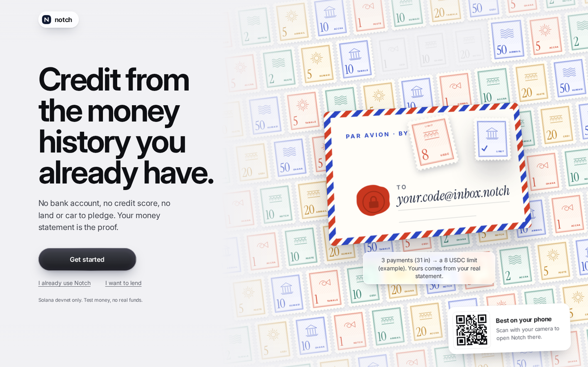

</div>

## What it does

- **Get a limit.** Your mobile money provider emails your statement to a private Notch inbox. A sealed server checks the email's signature and turns it into a credit limit. It never keeps the statement.
- **Borrow.** Put down 20%, take the rest in USDC, pay back with a flat 2% fee.
- **Lend.** Put USDC in the pool. Pick **Safe** (paid first, smaller share of fees) or **Risky** (takes losses first, bigger share).
- **Any app can check.** Other Solana programs call `check_credit` and get a yes or no plus a coarse band, never the exact limit.

## Screenshots

<table>
  <tr>
    <td align="center" width="200">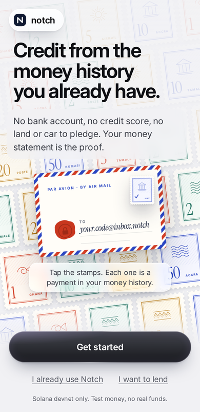<br><sub><b>Landing.</b> Tap a stamp, the example limit grows.</sub></td>
    <td align="center" width="200">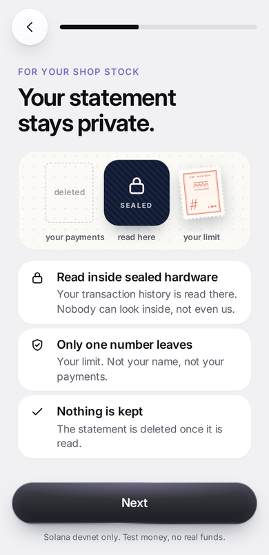<br><sub><b>Private.</b> The statement goes in, only a limit comes out.</sub></td>
    <td align="center" width="200">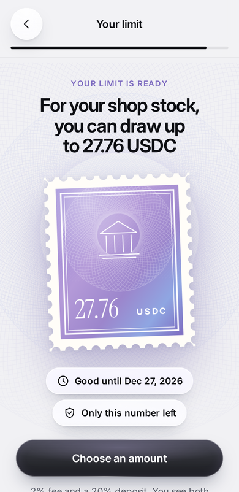<br><sub><b>Your limit.</b> Said for what you need the money for.</sub></td>
  </tr>
  <tr>
    <td align="center" width="200">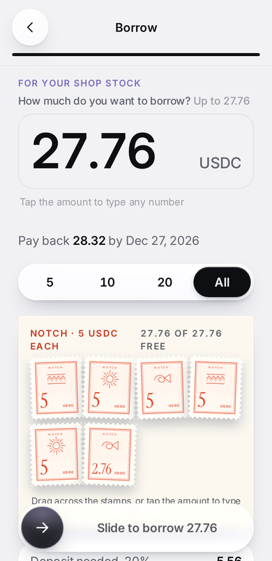<br><sub><b>Borrow.</b> Amount, 20% deposit and fee, up front.</sub></td>
    <td align="center" width="200">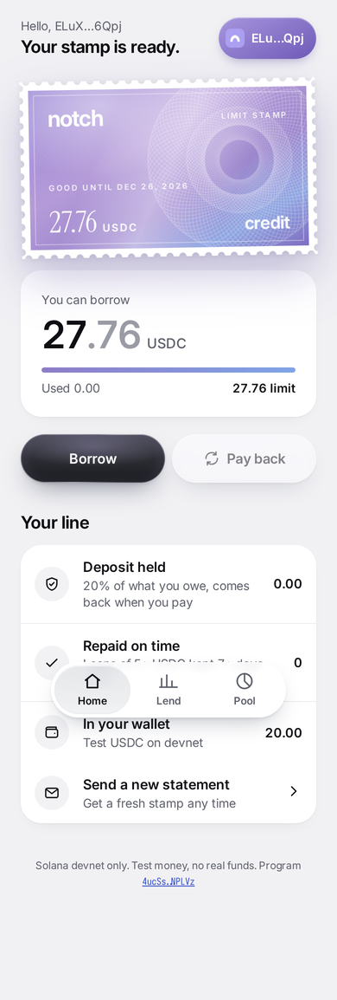<br><sub><b>Home.</b> What you can borrow and what you owe.</sub></td>
    <td align="center" width="200">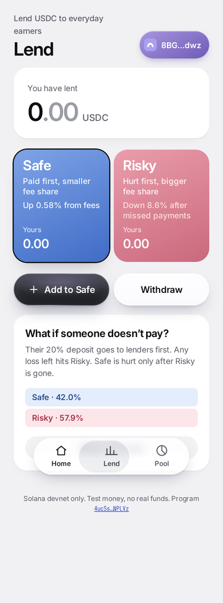<br><sub><b>Lend.</b> Safe or Risky, in plain words.</sub></td>
  </tr>
</table>

<p align="center">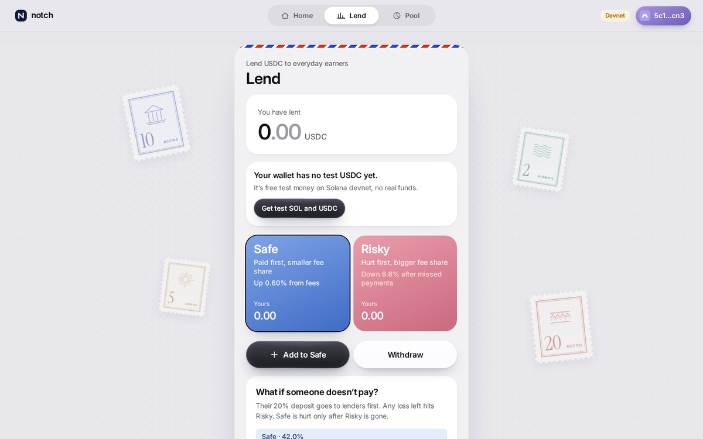<br><sub><b>On a laptop.</b> A slim top bar and one framed column. The app is made for the phone.</sub></p>

## How it works

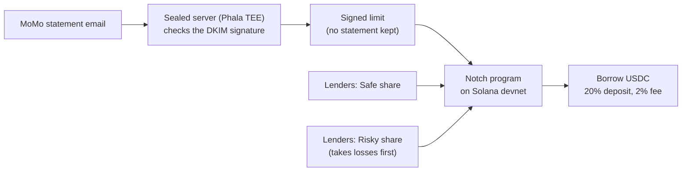

1. The borrower gets a one-time inbox address and asks MTN MoMo to email a statement there.
2. The sealed server checks the email's DKIM signature, so an edited or forged email fails. It signs a limit for one wallet and deletes the email.
3. The Solana program checks that signature, then lets the wallet draw up to the limit.
4. A missed payment sends the borrower's deposit to lenders first. Any loss left hits Risky, then Safe.

## On chain

| | |
|---|---|
| Program (devnet) | [`4ucSsrca8WS9LxJvoQZdhFscYnZ8DGDKMYcBhmBNPLVz`](https://explorer.solana.com/address/4ucSsrca8WS9LxJvoQZdhFscYnZ8DGDKMYcBhmBNPLVz?cluster=devnet) |
| Sealed server attestation | [Phala attestation](https://0015f90bd03804232678c956ce789b09384f4b1d-8787.dstack-pha1-prod9.phala.network/attestation) |
| Web app | [notch-bureau.onrender.com](https://notch-bureau.onrender.com) |
| Android | [Sideload the APK](app/android-release/README.md) |

## Sponsors & partners

Notch was built for the [Dev3pack Hackathon](https://hack.dev3pack.xyz). Logos from the [hackathon site](https://hack.dev3pack.xyz/#partners).

<table>
  <tr>
    <td align="center" width="260">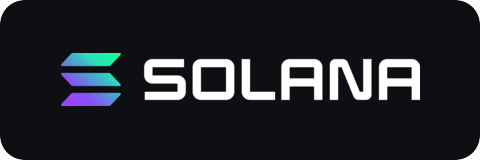</td>
    <td><b>Solana.</b> The Notch program, credit lines, the lender pool and test USDC all live on Solana devnet.</td>
  </tr>
  <tr>
    <td align="center"></td>
    <td><b>Solana Mobile.</b> An Android APK that signs with Mobile Wallet Adapter (Phantom, Solflare, Seed Vault). The web app offers it in Android Chrome too.</td>
  </tr>
  <tr>
    <td align="center"></td>
    <td><b>Supabase.</b> Sign in with Solana guards the inbox; Realtime shows the statement's status live; a pg_cron job runs the overdue-loan keeper. No statement data is stored there.</td>
  </tr>
  <tr>
    <td align="center"></td>
    <td><b>Firecrawl.</b> Hackathon sponsor. Not used in Notch.</td>
  </tr>
  <tr>
    <td align="center">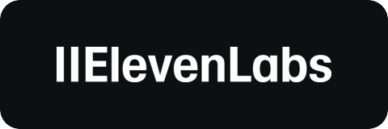</td>
    <td><b>ElevenLabs.</b> Hackathon sponsor. Not used in Notch.</td>
  </tr>
</table>

**Supporters:** 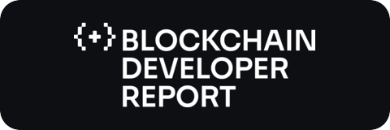 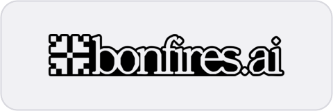 &nbsp; **Organiser:** 

### Built with

| Tool | What it does in Notch |
|---|---|
| [Phala](https://phala.network) | Runs the sealed server in a TEE (Intel TDX), with a public attestation. |
| [AgentMail](https://agentmail.to) | Gives each borrower a one-time inbox for their statement. |
| [Anchor](https://www.anchor-lang.com) | The Solana program framework. |
| [Render](https://render.com) | Hosts the web app and the test-money faucet. |
| [Pollar](https://pollar.xyz) | Optional "Continue with Google" wallet, no seed phrase. |
| [WalletConnect](https://walletconnect.network) | Wallet list on iPhone Safari and a QR code on desktop. |

## Run it locally

```sh
pnpm install
pnpm test               # program tests (LiteSVM)
pnpm test:enclave       # sealed server tests

cd app
pnpm install
cp .env.example .env.local   # then fill in the devnet values
pnpm demo:enclave            # local sealed server (says "local-dev")
pnpm dev                     # the app on http://localhost:5173
```

Browser tests: `cd app && pnpm e2e:browser:devnet` (Playwright against devnet).
Do not send a real statement to a local server.

## Repo layout

```text
programs/notch           Solana program: limits, pool, Safe/Risky shares, borrow, repay, check_credit
programs/hostel-deposit  Example app that calls check_credit before a booking
enclave/                 Sealed server: inbox, DKIM check, signed limits
app/                     React web app, Android shell (Capacitor), Playwright tests
sdk/                     @notch/bureau: read a wallet's credit from any app
supabase/                Schema, Realtime status, keeper cron
deploy/phala/            Phala TEE deployment
tests/                   Program tests (LiteSVM)
```

## Honest limits

- Devnet only. Not audited. Not for real money.
- Today it reads MTN MoMo statements only.
- The exact limit is public on chain; `check_credit` returns only a band. Mainnet would hide it.

More: [Research](RESEARCH.md) · [Sealed server](enclave/README.md) · [Supabase](supabase/README.md) · [SDK](sdk/README.md) · [Android](app/android-release/README.md)

## License

No license file yet. All rights reserved until one is added.
